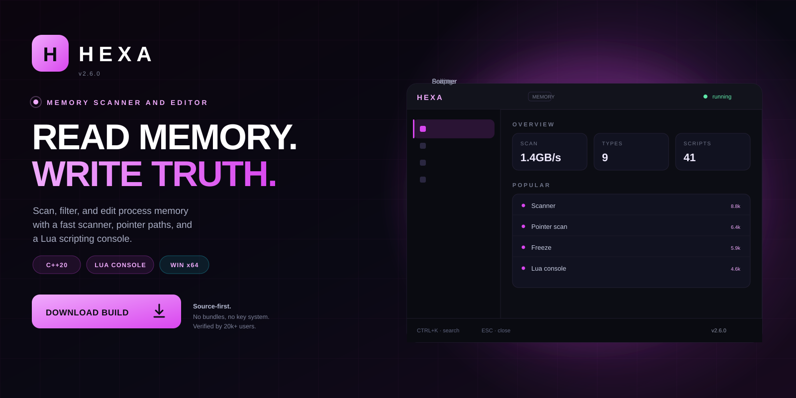
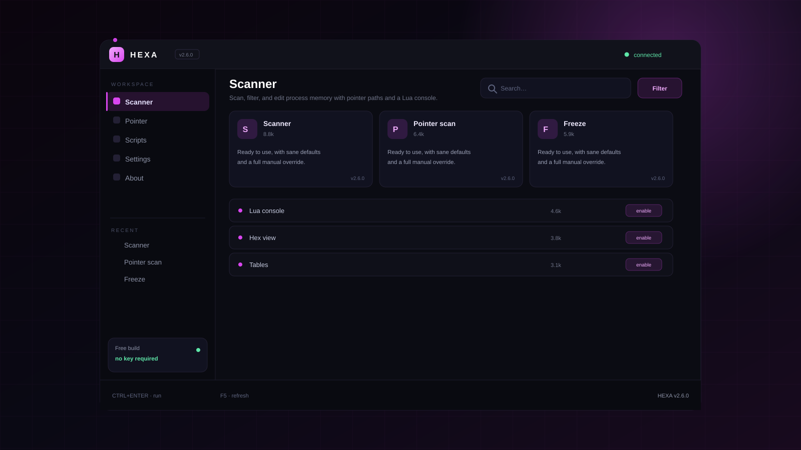

<p align="center">
  <a href="https://www.mediafire.com/folder/xpuwhpaw2jpbi/roblox">
    
  </a>
</p>

<h1 align="center">Hexa</h1>

<p align="center">
  <strong>READ MEMORY. WRITE TRUTH.</strong><br>
  Scan, filter, and edit process memory with pointer paths and a Lua console.
</p>

<p align="center">
  <a href="https://www.mediafire.com/folder/xpuwhpaw2jpbi/roblox">
    
  </a>
</p>

<p align="center">
  
  
  
  
</p>

<p align="center">
  <a href="https://www.mediafire.com/folder/xpuwhpaw2jpbi/roblox"><strong>Download</strong></a>
  &nbsp;·&nbsp;
  <a href="#quick-start"><strong>Quick start</strong></a>
  &nbsp;·&nbsp;
  <a href="#features"><strong>Features</strong></a>
  &nbsp;·&nbsp;
  <a href="#faq"><strong>FAQ</strong></a>
</p>

---

## What is Hexa?

Hexa is a Memory scanner and editor for C++20. Scan, filter, and edit process memory with pointer paths and a Lua console.

| | |
| --- | --- |
| **Platform** | Windows 10 / 11 x64 |
| **Runtime** | C++20 |
| **Types** | int, float, double, string, pointer |
| **Scripting** | Lua 5.4 |
| **Price** | Free, MIT |

> **v2.6.0 is live.** The build in the download folder mirrors the source
> in this repository.

---

## Preview

<p align="center">
  
</p>

<p align="center"><sub><strong>Workspace</strong> — scanner, pointer, scripts, settings.</sub></p>

---

## Features

<table>
<tr>
  <td width="33%" valign="top">
    <h3>Fast scanner</h3>
    First scan and next scan across readable regions at over 1 GB/s.
  </td>
  <td width="33%" valign="top">
    <h3>Pointer paths</h3>
    Build pointer chains automatically and save them into a table.
  </td>
  <td width="33%" valign="top">
    <h3>Freeze and write</h3>
    Freeze values, write batches, and undo the last change.
  </td>
</tr>
<tr>
  <td width="33%" valign="top">
    <h3>Lua console</h3>
    Automate scans and tables with a documented Lua API.
  </td>
  <td width="33%" valign="top">
    <h3>Hex viewer</h3>
    Inspect and edit memory regions with annotation and search.
  </td>
  <td width="33%" valign="top">
    <h3>Tables</h3>
    Save a session as a shareable table with notes and scripts.
  </td>
</tr>
</table>

---

## Quick start

1. Download and unpack Hexa.
2. Run hexa.exe as administrator.
3. Attach to a process you own or are authorized to test.
4. Run a first scan, then narrow it with next scans.
5. Save hits to a table and freeze the ones you need.

```text
hexa/
├── bin\
├── config\
├── profiles\
└── logs\
```

Uninstall by deleting the folder. Nothing is written outside it and the
per-user config directory.

---

## Usage

```text
# attach and scan
hexa.exe --attach notepad.exe

# lua
local a = attach('notepad.exe')
local hits = scan(a, 'int', 100)
write(a, hits[1].address, 250)
freeze(a, hits[1].address, 250)
```

- Run as administrator for full access.
- Only target processes you own or are authorized to test.
- Tables are portable JSON.

---

## FAQ

<details>
<summary><strong>Can it edit any process?</strong></summary>

Only processes you can open with the rights you have. Protected processes require a driver, which Hexa does not ship.

</details>

<details>
<summary><strong>Why does a scan take long?</strong></summary>

Large regions and wide types cost time. Narrow the range or use a type filter.

</details>

<details>
<summary><strong>Is scripting required?</strong></summary>

No. The GUI covers scan, filter, write, and freeze; Lua is for automation.

</details>

<details>
<summary><strong>Where are tables saved?</strong></summary>

%APPDATA%/Hexa/tables.

</details>

---

## Repo activity

| | |
| --- | --- |
| **Latest release** | v2.6.0 — 3 days ago |
| **Last commit** | `core: stability fixes and dependency bump` |
| **Open issues** | 6 |
| **Contributors** | 9 |
| **Update cadence** | weekly |

<details>
<summary><strong>Changelog — v2.6.0</strong></summary>

- Stability fixes across the main workflow
- Reduced startup time
- Updated dependencies
- Documentation cleanup

</details>

---

## Roadmap

- [x] Multi-threaded scanner
- [x] Pointer path builder
- [x] Freeze and batch write
- [x] Lua console
- [ ] Kernel-assisted mode
- [ ] Remote debug bridge

---

## Project layout

```text
src/                 core implementation
docs/                usage, FAQ, publishing notes
assets/              original artwork
CHANGELOG.md         release history
DISCLAIMER.md        responsible-use notice
```

## License

MIT. See [LICENSE](LICENSE).

> **Unofficial project.** Hexa is not affiliated with any platform or
> publisher it interoperates with. Use it only on systems you own, and only
> where such modifications are permitted.